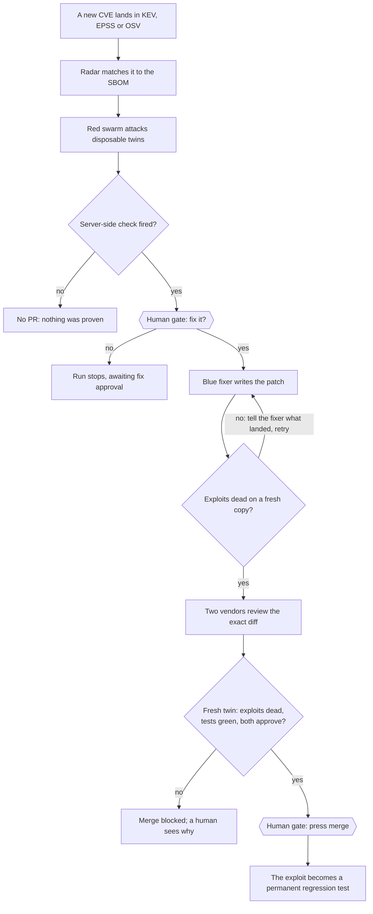

# NEO

Nothing reaches your cloud without proof.

I built this at Hackathon Portugal 2026, hosted by Leaseweb and Velv at DeHouse in Lisbon, for the
"AI for Cloud Infrastructure" challenge, direction 3: track new exploits and help find, patch and
mitigate them.

Attackers already point AI at every target on the internet. A security team cannot read every
diff and run every scanner by hand fast enough to keep up. NEO is the other side of that: an AI
team that attacks your own system first, on a disposable copy, proves the hole is real, writes the
fix, and proves the fix closes the hole before a human merges anything.



## How trust works

Only the server decides: a flag check reads the twin's own event log, and a model's report never
marks an attack as working or a fix as done. A finding counts only when that check fires or a
second model reproduces it, and the secrets an attack must steal are random on every run, so no
model can pass by remembering them. Two reviewers from two vendors read the exact diff, every claim
they make must quote a line of it, and each review is bound to the diff's sha256 digest, so a
changed byte voids it. Before anything can merge, a fresh twin is built from that exact diff and
the same exploit runs again: it must fail, and the tests must pass. Then a human presses merge,
because NEO never does.

[docs/ARCHITECTURE.md](docs/ARCHITECTURE.md) maps every part to its file and lists what each check
defends against, and where NEO stops today.

## The loop

1. The radar builds an SBOM of the target, matches it against the CISA KEV feed, EPSS and OSV, and
   ranks what to look at first: in KEV, then high EPSS, then reachable from the app.
2. A small swarm of open-weight models attacks the target, each model in its own disposable twin.
   A finding only counts when a server-side check on the twin confirms it, or a second model
   reproduces it. The agents never get to grade their own work.
3. A human can stop the run here. With `--ask`, NEO shows what it proved and waits for a yes before
   it touches any code.
4. A fixer model reads the finding and the code and writes the patch. NEO replays every exploit on
   a fresh patched copy and checks that a normal login still works. If an exploit still lands, the
   fixer hears exactly which one and tries again, up to three times. If no model patch holds, NEO
   uses the documented fix in `demo-target/FIXES.md` and records that it did.
5. The verified patch goes out as a pull request with the exploit request and the server-side
   proof that the hole was open before the patch.
6. Two reviewers from two different vendors read the diff. Each one writes a draft, then re-derives
   every claim from the diff in a second pass before it posts. Both have to approve. Disagreement
   goes to a human with both opinions side by side, never to a vote.
7. A fresh twin is built from the exact diff the reviewers read, the same exploit runs again, and
   the gate reads the result from the twin's own server-side log. The pull request can merge only when the
   exploit is dead, the tests are green, and both reviewers approved that exact diff. A human
   presses merge.
8. Every exploit NEO proves becomes a permanent regression test and an attack replay. The suite
   replays it against the vulnerable target, where it must land, and against the fix, where it must
   die, and CI runs that on every push and every night, so a closed bug cannot come back silently.
   After a human merges, the factory also writes the fix to a permanent regression record.

## It ran for real

The whole loop ran while I built it. The radar pulled the live KEV feed, merged one staged entry
for a real PyYAML CVE (CVE-2020-14343, which the live feed does not list; the fixture says so), and
matched it to the target's SBOM. The red swarm proved a SQL injection, an SSRF chain and a forged
JWT on disposable twins. The fixer's own patch verified, and it opened
[pull request #1](https://github.com/Jinstronda/neo-hackathon/pull/1). One reviewer approved and
the other asked for changes on a technicality: its second pass agreed the fix was right but quoted
no line of the diff, and NEO's rule is no quote, no approval, so the merge waits for a human. A
rebuilt twin showed all three exploits dead with ten tests passing. From the first proven exploit
to the merge gate took 7.75 minutes and 21 model calls, about $0.09 at gateway rates.

The run, the PR, and the reviews are in this repo exactly as they happened:
`runs/demo-run/events.jsonl` has every event and `runs/demo-run/run.json` the summary.

## Talk to it

`neo chat` is the terminal agent. You tell it to attack your server and it does, on a
disposable copy: it scopes the target, sends the red swarm, shows the server-side proof, and asks
before it fixes anything. The fix tool cannot run until you type `y`, and that gate is in the code
(`neo/chat.py`), where no prompt can talk past it.

Here is a real session in `--mock` mode, trimmed. Mock mode needs no gateway: a scripted model does
the talking, the reference exploit chain stands in for each red model, the offline fixer proposes
nothing so the documented fix ships, and an offline stand-in plays both reviewers. The twins, the
exploits, the replay and the server-side checks are real.

```text
$ neo chat --mock
you> Neo, attack our server
  . neo runs attack(swarm=3)
+00:00  radar    CVE-2020-14343  pyyaml 5.3.1   KEV yes   EPSS 0.0624   reachable yes
+00:00  [RED]    A1 sql-injection @ POST /login username parameter
                  found by model-1, model-2, model-3  ·  confirmed by server-side flag check
+00:01  [RED]    B1 ssrf @ POST /import-avatar url parameter
+00:02  [RED]    C1 weak-jwt-secret @ GET /admin/whoami forged admin token
neo> ... I found something. Should I fix it?
you> fix it
  . neo runs fix()
  fix it? [y/N] y
+00:03  fix      attempt 2/3  canonical patch  verified
                  fresh copy: sql-injection dead, ssrf-metadata dead, weak-jwt-secret dead
+00:03  patch    PR #7  local://pr/7
+00:27  flag     sql-injection  post-patch  objective_complete=false
+00:28  gate     post-patch replay: green   gate_pass=True
+00:33  tests    66/66 passed   (3 regression tests added)
+00:33  merge    PR #7  ready_to_merge=True   awaiting human
neo> Fixed. The patched twin replayed the same exploit and it failed, ... It is ready for a human to merge.
```

## 24/7

`neo watch` rescans the SBOM against the live KEV feed every six hours (`--interval`
changes that). Each match it has not seen before starts one full loop, and a run that fails stays
unseen so the next cycle retries it. `--once` runs a single cycle for cron, and `--local` keeps
every PR local.

CI keeps the memory. `.github/workflows/ci.yml` runs lint, the regression suite and the scenario
harness on every push and pull request, and again every night at 03:17 UTC, so a fixed bug that
comes back turns CI red even on a day nobody pushes. `.github/workflows/retest.yml` gates every pull
request that changes the target: it rebuilds a twin from the patched code and fails unless every
exploit is dead.

## Try it

The live console: [neo-console.vercel.app](https://neo-console.vercel.app). It replays the real
run above by default; signing in with the team login lets it talk to a live engine run instead.

Everything is Python 3.11+ and the standard library. No model calls are needed for the first block.

```bash
git clone https://github.com/Jinstronda/neo-hackathon && cd neo-hackathon
python3 -m venv .venv && source .venv/bin/activate
pip install -e ".[dev]"                # the neo command, plus pytest and ruff

pytest -q tests                        # every fixed bug stays fixed
neo harness run --all --agent mock     # every scenario, judged server-side
neo chat --mock                        # the terminal agent, offline
neo term replay runs/demo-run --slow   # watch the real run again
```

Without installing, `python -m neo` takes the same arguments. To run the real loop, copy
`.env.example` to `.env` and fill in `HOMODEUS_API_KEY`, the gateway base URL and the red swarm
model ids. Then `neo run --local --ask`.

| Command | What it does | Needs |
|---|---|---|
| `neo run --local --ask` | The whole loop once. Asks before fixing; records the PR under `runs/prs/`. | gateway |
| `neo run` | The whole loop with a real PR on `$NEO_REPO`. `--swarm N` widens the red swarm, `--max-fix-attempts N` sets the fixer's tries. | gateway, `gh` |
| `neo watch --once --local` | One 24/7 cycle: rescan, run the loop on each new KEV match. | network, gateway on a match |
| `neo chat` | The terminal agent on the real chat model. `--mock` runs it offline. | gateway |
| `neo radar` | SBOM against KEV, EPSS and OSV. Falls back to the staged entry offline. | network |
| `neo harness run --all --agent mock` | Every scenario on its own disposable target, no LLM. | nothing |
| `neo replay --phase pre-patch` | Build a Docker twin and replay every exploit; at least one must land. | Docker |
| `neo term replay runs/demo-run --slow` | Print a recorded run as it happened. | nothing |
| `pytest -q tests` | The regression and attack-replay suite. | nothing |

`neo/config.py` holds the model ids for each role, read from the env. `neo/llm.py` is the one place
every model call goes through; nothing in this repo calls a provider SDK directly.

## What it is built from

Everything here is new code written for this hackathon, Apache-2.0, mostly Python with a
TypeScript console. The design borrows from work I already own: a breachbench-style harness with
randomized, server-verified scenarios, and a KEV/EPSS/OSV radar, both rebuilt clean for this repo
rather than copied, since the originals carry a different license. The SBOM comes from Syft
(Apache-2.0) when it is installed, with a plain `requirements.txt` parser as the fallback, and the
advisories come from the public CISA KEV, FIRST EPSS and OSV feeds. The red swarm runs on
open-weight models on our own EU servers. The two reviewers come from two vendors, OpenAI and
Anthropic. Every model is reached only through one LLM gateway, so no raw API key sits in this
repo.

## Where things are

- `demo-target/`, the vulnerable demo app the whole loop attacks: a SQL injection auth bypass, an
  SSRF chain to a fake metadata service, a forged-JWT admin bypass, and one outdated dependency
  with a real CVE. `FIXES.md` documents the intended fix for each; the patched code is never
  checked in ahead of time.
- `checks/`, the server-side flag checks. They read only the target's own event log. An agent's
  claim is never the source of truth.
- `neo/`, the engine: `radar.py`, `red.py`, `blue.py`, `reviewers.py`, `gate.py`, `factory/` and
  `orchestrator.py`, plus `chat.py`, `watch.py` and the `neo` CLI in `__main__.py`.
- `infra/`, builds a disposable twin, locally in Docker or on a remote box over SSH, and replays
  the exploits against it.
- `tests/`, the regression and attack-replay suite: each proven exploit must land on the vulnerable
  target and die on the fixed one.
- `console/`, the Next.js app at neo-console.vercel.app: the agent board, the incident timeline,
  the radar, the numbers, and a chat that talks to the loop.
- `runs/demo-run/`, the real run from this session: every event, the patch, the reviews, the
  before-and-after proof.
- [docs/ARCHITECTURE.md](docs/ARCHITECTURE.md), [docs/RUN_SCHEMA.md](docs/RUN_SCHEMA.md) and
  [SECURITY.md](SECURITY.md) for the parts, the event format, and responsible use.

## License

Apache-2.0. See `LICENSE`.
