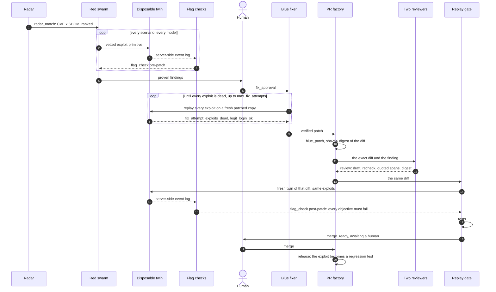

# Architecture

NEO is ten small parts and one rule. The rule: no model decides whether an attack worked or a fix
holds. The target's own server-side log decides, and a human merges.

## The ten parts

| Part | Where it lives | Its one job |
|---|---|---|
| Radar | `neo/radar.py` | SBOM the target, match it against CISA KEV, EPSS and OSV, and rank the worklist: in KEV first, then EPSS, then reachable. |
| Twin | `neo/harness/target.py`, `infra/twin_local.py`, `infra/twin_server.py` | Boot a disposable copy of the target with fresh random secrets and its own event log, bound to localhost, and tear it down after. |
| Red swarm | `neo/red.py`, `neo/harness/agent.py` | Give each open-weight model its own twin. The model plans and picks attacks from a fixed toolbox of vetted exploit primitives. |
| Judge | `checks/check_*.py`, `checks/_events.py`, `neo/harness/scenarios.py` | Read the twin's event log and return `objective_complete`. This is the only verdict that counts. |
| Blue fixer | `neo/blue.py` | Ask the fixer model for a root-cause patch, replay every exploit on a fresh patched copy, and check that a normal login still works. |
| Replay gate | `neo/gate.py`, `infra/replay.py` | Apply the PR's exact diff to a fresh copy, build a twin from it, replay the same exploits, run the tests, and compute merge readiness. |
| Two-vendor reviewers | `neo/reviewers.py` | Two models from two vendors each write a draft review, then re-derive every claim in a second pass. Each claim must quote a line of the diff. |
| PR factory | `neo/factory/__init__.py`, `neo/factory/github.py` | Open the PR with the evidence, bind every review to the patch digest, refuse "ready" until the gate passes, and record the regression after a human merges. |
| Journal and evidence store | `neo/journal.py`, `runs/<id>/`, [`RUN_SCHEMA.md`](RUN_SCHEMA.md) | Append one JSON event per step to `events.jsonl` and write `run.json`. The terminal view and the console read only this. |
| LLM gateway boundary | `neo/llm.py`, `neo/config.py` | The one place a model is called. It reads the key from the environment, retries, counts tokens and cost, and nothing else in the repo talks to a provider. |

`neo/orchestrator.py` runs the parts in three phases: `start` opens a fresh run and its journal,
`attack` runs the radar and the red swarm, and `remediate` runs everything from the fixer to the
merge gate. `loop` runs all three, with an optional human approval between attack and remediate.
Three front ends drive it: the CLI (`neo/__main__.py`), the terminal agent (`neo/chat.py`), which
stops after `attack` and asks before it calls `remediate`, and the 24/7 watcher (`neo/watch.py`),
which starts one loop per new KEV match. `neo/term.py` prints the journal as it grows.

## One run

## The trust model

Each check exists because a part of the loop can fail in a specific way.

| What could go wrong | The check that stops it | Where |
|---|---|---|
| A model says the attack worked when it did not. | The flag check reads the twin's own event log. The model's report and the exploit's exit code never decide. | `checks/`, `neo/red.py` |
| A model memorized the flag or the admin password. | The flag, the admin password and the metadata key are random per process, and each Docker twin gets its own flag. | `demo-target/app.py`, `infra/twin_local.py` |
| One model hallucinates a finding. | A finding counts only when the server-side check fires, or a second model reproduces the same class. | `neo/red.py` (`prove`) |
| A model runs something harmful against the target. | Models choose from three vetted exploit primitives. They cannot send arbitrary code to the target. | `neo/harness/agent.py` (`TOOLBOX`) |
| A fix closes the hole by breaking the app. | Every candidate patch is replayed on a fresh copy, and a guest login must still succeed. | `neo/blue.py` (`verify`) |
| A reviewer hallucinates. | Every claim must quote a line that exists verbatim in the diff. No quote, no approval. | `neo/reviewers.py` (`decide`) |
| A reviewer rubber-stamps its own first draft. | A second pass re-derives each claim and traces the exploit through the patched code. Both passes must approve. | `neo/reviewers.py` (`_recheck`) |
| The diff, the finding or repo text carries a prompt injection. | Reviewers see them inside `<untrusted>` tags and are told never to follow them. | `neo/reviewers.py` |
| One vendor's blind spot. | Two reviewers from two vendors. A split goes to a human side by side, never to a vote. | `neo/reviewers.py` (`side_by_side`) |
| A review approves an older diff. | Each review carries the sha256 digest of the patch. A changed diff voids it. | `neo/factory/__init__.py` (`blockers`) |
| A fix only works on the fixer's copy. | The PR's exact diff is applied to a fresh copy with `git apply`, a new twin is built from it, and the same exploits run again. | `neo/orchestrator.py` (`_retest`), `neo/gate.py`, `infra/replay.py` |
| An agent merges its own fix. | NEO never merges. `release` refuses without a human merge signal and, on GitHub, a merged PR. | `neo/factory/__init__.py` (`release`) |
| The CI gate fails open. | The replay step runs with `set -o pipefail`, so a live exploit fails the job even when output is piped. | `.github/workflows/retest.yml` |
| A closed bug comes back. | Each proven exploit stays in the test suite, and CI replays it on every push and every night. | `tests/`, `.github/workflows/ci.yml` |
| Exploit output attacks the operator's terminal. | Control bytes are stripped from every event before it is printed. | `neo/term.py` |

## Limits

These are true today, and a buyer should know them.

- The tested surface is three scenarios on one demo app: SQL injection, an SSRF chain and a forged
  JWT. `GET /me` and `GET /` have no adversarial scenario yet, and every run reports that as
  `untested_surface`.
- The red models reason about the target and choose among vetted primitives. They do not write new
  exploits. NEO proves known bug classes; it does not find zero-days.
- The KEV match is staged. CVE-2020-14343 in PyYAML is a real CVE with a public advisory, but it is
  not in the live CISA KEV feed, so the radar merges one staged entry
  (`neo/fixtures/kev_staged.json`) with the live feed to guarantee a demo match. "Reachable" means a
  direct dependency; the radar does not prove the vulnerable code path runs.
- When the fixer model's patch does not verify, NEO falls back to the documented fix in
  `demo-target/FIXES.md`. `run.json` records `patch_source` as `model` or `canonical`, so a green run
  says who wrote the fix.
- The strict reviewer rule produces false negatives. On PR #1 the correctness reviewer agreed the
  fix was right but quoted no diff line in its recheck, so the merge waited for a human.
- Without Docker the gate falls back to an in-process twin: the same checks decide, with no
  container isolation. The journal records a `twin_fallback` event when this happens.
- `infra/twin_server.py` builds the same twin on a remote box over SSH and has its own self-test. The
  loop uses the local Docker twin.
- The static test suite assumes `demo-target/` is the unpatched baseline, so CI skips it on a PR
  that only changes `demo-target/`. The retest gate covers those PRs.
- `cost_usd` is an estimate from the gateway's token counts and a price table in `neo/llm.py`.
- `neo watch` runs in the foreground or from cron. This repo ships no service for it, and it has not
  yet run unattended for days.
